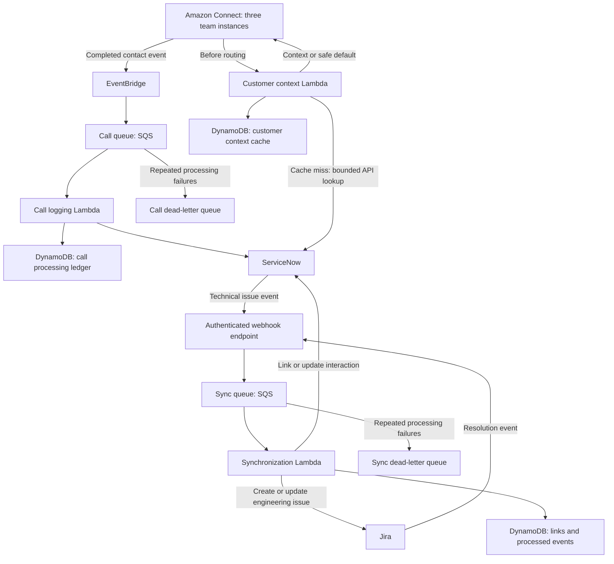

# Multi-Team Call Center Integration

## Overview

This repository proposes an integration between Amazon Connect,
ServiceNow, and Jira for three teams: Support, Sales, and
Technical Account Management.

Each team receives approximately 500–1,000 calls per day.
Currently, agents manually log calls in ServiceNow, technical
issues are tracked separately in Jira, and customer context
is not shared across the systems.

## Goals

- Automatically record completed calls in ServiceNow.
- Prevent duplicate records when events are retried.
- Keep related call transfers linked to the same interaction.
- Retrieve customer context before routing an inbound call.
- Synchronize technical issues between ServiceNow and Jira.
- Deploy gradually and recover safely from failures.

## Scope

This is an architecture and deployment design proposal.
The repository includes documentation and illustrative Python
examples. It does not deploy a production integration.

## Proposed Approach

Use an event-driven design for call logging and ticket
synchronization. Queues hold work while external systems are
unavailable, allowing failed operations to be retried.

Use a separate, time-limited customer-context lookup for
inbound routing. If customer context cannot be retrieved
quickly, the call follows the normal routing path.
## Architecture Diagram



### Main Components

| Component | Purpose |
| --- | --- |
| EventBridge | Select completed contact events from the three Connect instances. |
| SQS queues | Hold call and synchronization messages until workers can process them. |
| Lambda workers | Run the integration logic and call external APIs. |
| DynamoDB | Track processed calls, record links, and cached customer context. |
| Dead-letter queues | Hold repeatedly failed messages for investigation and controlled replay. |
| Authenticated webhook endpoint | Receive change notifications from ServiceNow and Jira. |
| ServiceNow | Store customer interactions and their Jira links. |
| Jira | Track engineering work and its resolution. |

### Design Assumptions

- ServiceNow interactions are the records used for automatic call logging.
  The exact table and required fields will be confirmed with its owner.
- ServiceNow can enforce a unique external call key to prevent duplicate creates.
- Related transfer contacts can be identified and grouped using Connect contact relationships.
- Customer context is retrieved using a verified customer or account identifier.
- ServiceNow and Jira can send authenticated change notifications.

## Documentation guide

- [Architecture](ARCHITECTURE.md): Three integration phases and processing flows.
- [Idempotency](IDEMPOTENCY.md): Duplicate prevention and recovery.
- [Deployment](DEPLOYMENT.md): Environment integration and phased rollout.
- [Rollback](ROLLBACK.md): Safe rollback and partial-data recovery.
- [Monitoring](MONITORING.md): Metrics, alerts, and reconciliation.

## Running the code examples

Requirements: Python 3.10 or later. No additional packages or credentials are required.

From the repository root, run:

```bash
python examples/call_logging.py
python examples/ticket_sync.py
```

On Windows, you can use `py` instead of `python`.

### Call logging example

Demonstrates duplicate prevention, transfer correlation, and recovery when a record is created but the response times out.

Expected result: three `PASS` messages.

### Ticket synchronization example

Demonstrates recovery after link storage fails, duplicate-event suppression, Jira resolution updates, stale-event handling, and suppression of a specific integration echo.

Expected result: five `PASS` messages.

## Example limitations

These examples use in-memory simulated records and run sequentially. They illustrate the processing logic; they are not deployed integrations.

Production requires durable storage, conditional claims, per-record serialization, authenticated APIs and webhooks, and destination-side conflict controls. Jira creation timeouts require reconciliation before another create attempt; unresolved ambiguity must go to manual review.